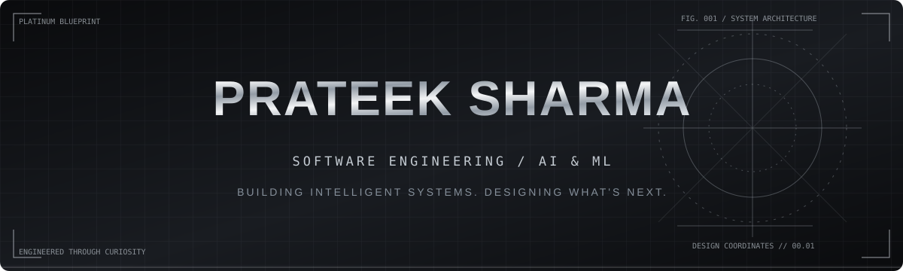
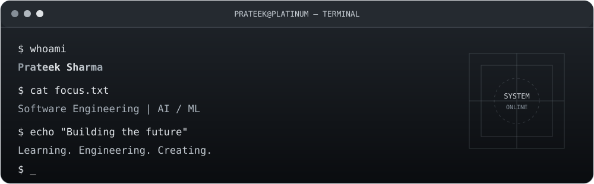
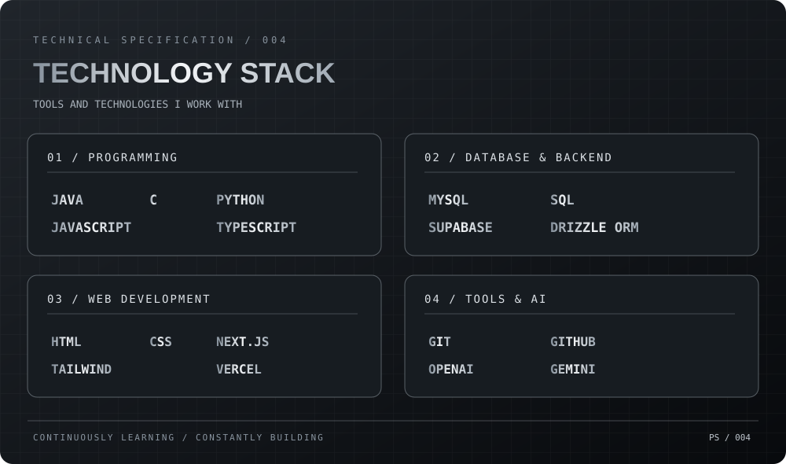
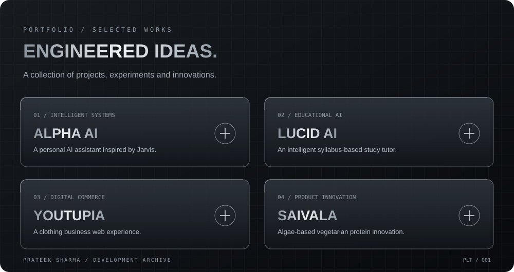

 

---

# ABOUT THE ENGINEER

**Prateek Sharma**

Software Developer | AI/ML Enthusiast

Building intelligent systems and engineering practical solutions.

[GitHub](https://github.com/Alphaaaaaa-dev) •
[LinkedIn](https://www.linkedin.com/in/prateek-sharma-31650739a/) •
[Portfolio](https://youtupia.in)

---

## 01 / TECHNOLOGY SPECIFICATION

---

## 02 / SELECTED PROJECTS

### Alpha AI
Personal AI assistant with voice interaction, desktop control, web search and automation.

### LUCID AI
AI-powered study tutor with syllabus-based learning and progress tracking.

### Youtupia
Clothing-business website and digital commerce project.

[Visit Website](https://youtupia.in)

### Saivala
Algae-based vegetarian plant-protein innovation and machine prototyping project.

---

## 03 / CONTRIBUTION ACTIVITY

---

## 04 / GITHUB ANALYTICS

---

### ENGINEERED WITH CURIOSITY.

**BUILD. LEARN. REPEAT.**

PRATEEK SHARMA / PLATINUM BLUEPRINT / 2026

